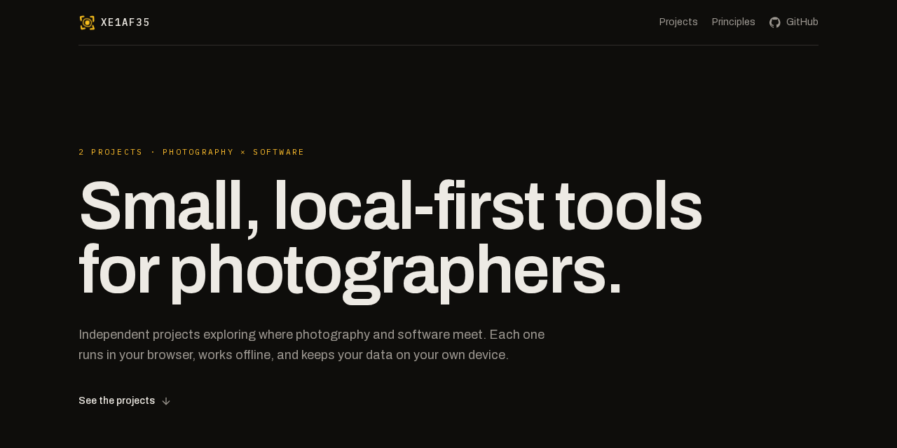

#  XE1AF35.github.io

**Small, local-first tools for photographers.**

The website for [XE1AF35](https://github.com/XE1AF35): one page showing each project, what it does, and the principles they all follow. It's live at **[xe1af35.github.io](https://xe1af35.github.io)**.

## Projects

| Project | What it does |
| --- | --- |
|  [Bodycap](https://github.com/XE1AF35/bodycap) | Organise your camera gear: bodies, lenses, kits, loans, and maintenance. [Open it](https://xe1af35.github.io/bodycap/) |
|  [Hotshoe](https://github.com/XE1AF35/hotshoe) | Log where you took a photo on your iPhone, then geotag it later with GPX or coordinates. [Open it](https://xe1af35.github.io/hotshoe/) |

## About this repo

This repo holds only the built site, which GitHub Pages serves as it is. The source is kept in a private repo and published here by a workflow, which replaces every file on each publish, so changes made here directly would be lost.
